# Inkly: a Shopify portfolio theme

A Shopify Online Store 2.0 theme for a fictional personalized-gifts store, built to show three things merchants and agencies keep asking for: **a product page with live personalization preview**, **a cart drawer with upsell and a free-shipping bar**, and **speed measured with Lighthouse**.

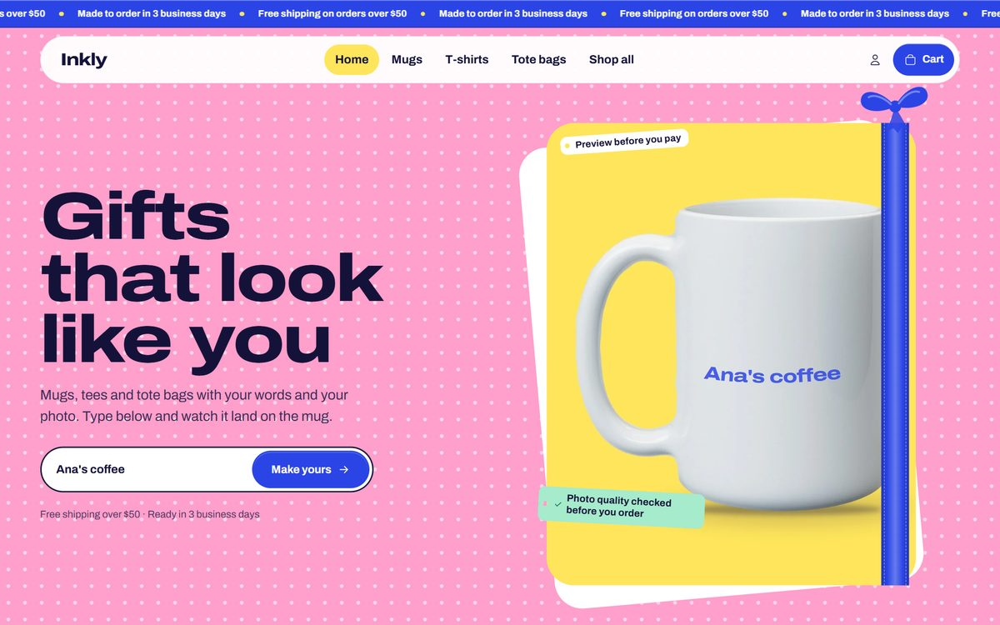

- Demo store: `inkly-demo.myshopify.com` (a development store, so it's password protected; ask for the password). Inside it, **How this store was built** (`/collections/how-this-store-was-built`, linked from the footer) walks through the five pieces with videos: the 3D preview, the personalizer, the cart drawer, the speed work and the companion app [Inkly ERP Sync](https://github.com/bielvelozo/inkly-erp-sync).
- Products, prices and reviews are fictional. No orders are fulfilled.
- Base: [Shopify Skeleton Theme](https://github.com/Shopify/skeleton-theme) v1.0.0 (commit `8b8a1f4`, license in `LICENSE.md`). Everything else was written from scratch for this repository.
- Storefront strings ship in English (default) and Brazilian Portuguese.

## The look: a gift-wrap counter

The whole store is wrapping paper. Each part of the home owns one paper (pink polka dots, lemon stripes, mint gingham, cobalt), a cobalt ribbon carries the live state (the announcement, the free-shipping progress in the cart, the steps rail on the home) and gift tags label what matters.

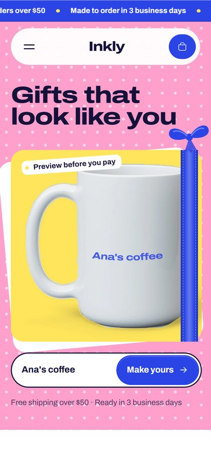 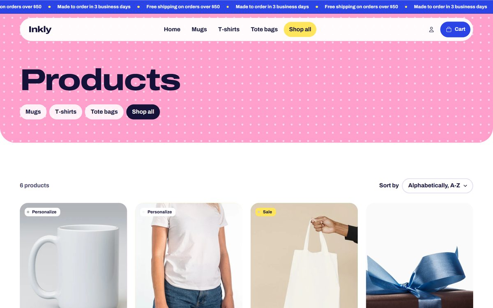

- **Type a name, see it on the mug.** The hero has a field that prints what the visitor types onto a real mug photo, live. "Make yours" opens the mug with that text already filled in the personalizer.
- **Type:** Archivo Expanded ExtraBold for headings, shipped with the theme (14 KB, SIL Open Font License); Archivo for body text, also shipped with the theme as static 400 and 700 instances (16 KB each) and changeable in the theme editor, where any other font comes from the Shopify font library.
- **Papers are CSS:** the patterns are tiny repeating images defined once in `assets/critical.css`, and their colors are theme settings.
- **Motion:** the steps ribbon draws itself as you scroll, the hero gets dressed (ribbon, bow, tags) right after load, tags swing on hover, "Add to cart" pops into "Added!", the cart badge bumps, and the free-shipping ribbon ties a bow with a burst of confetti. All of it is off under `prefers-reduced-motion`.
- **State shows on the paper:** on the product page the stage tag turns into a mint "Ready to print" once there is text or a sharp photo, and the stage paper turns lemon for dark products.
- **Pages:** home (hero, bestsellers, gift bento, how it works, reviews), collection, product, cart drawer and cart page, password page and a 404 shaped like "4[mug]4".
- **Built for thumbs and keyboards:** every tap target is at least 44 px on phones, every keyboard stop shows a focus ring, and Lighthouse accessibility is 100 on the home. Checked page by page at 375, 768 and 1440 px.
- **Photos** are free stock photos (Burst, Unsplash, Pexels), cropped by `demo/photos.py`; sources and licenses are in `demo/CREDITS.md` and in each file's metadata. The hero mug is cut out of its studio backdrop by `demo/cutout.py` (the body drawn from its measured geometry, the edge recoloured so no grey fringe shows) and laid on a lemon card, so a phone loads a 12 KB image instead of a heavy transparent one.

---

## 1. Product personalizer with live preview

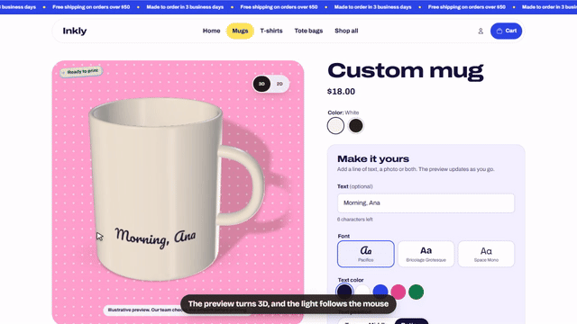

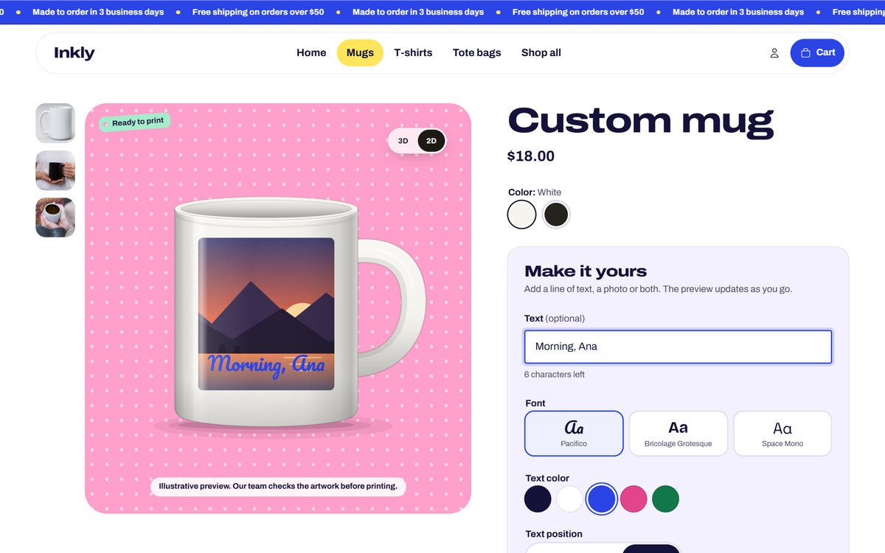

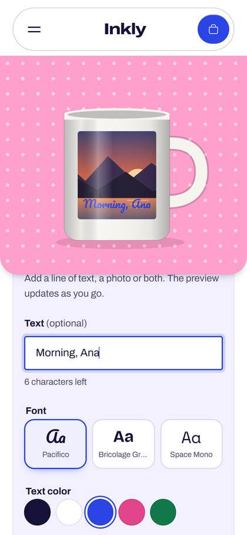 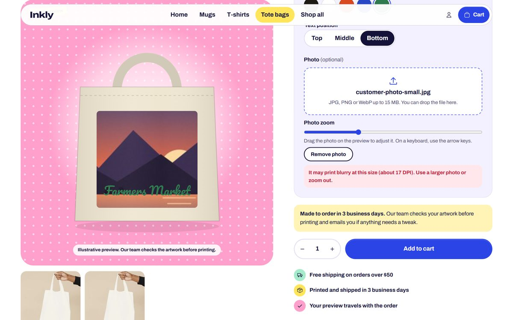

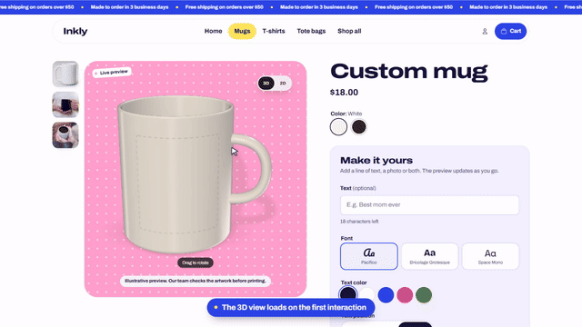 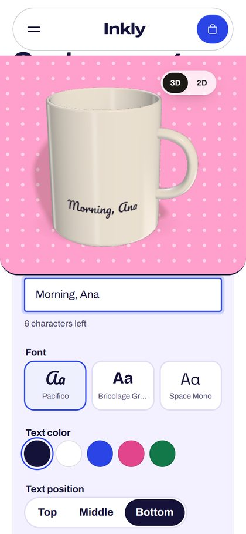

The customer types a line of text, picks a font, a color and a position, uploads a photo, drags and zooms it, and watches the mockup update as they go. On mobile the preview stays pinned to the top while they fill in the form.

- **SVG mockups** of a mug, a tee and a tote bag (`snippets/mockup.liquid`), tinted with the selected variant color. A merchant can also use their own mockup image and mark the print area in percentages.
- **Print quality check:** the theme computes DPI from the real print width (a setting) and warns before checkout when the photo will print blurry.
- **Contrast warning** when the text color nearly disappears on the product color.
- **Everything goes into the order** as line item properties: text, font, color, the original photo (uploaded through Shopify) and, hidden from the customer, the text position, the photo adjustment and a **preview image rendered in the browser** (canvas), which shows up in the cart and reaches production.
- **Live 3D preview** on top of the 2D mockup: a procedural three.js mug, tee and tote that print the customer's text and photo by mirroring the mockup `<svg>`, with light and reflections that follow the pointer and drag (or swipe) to turn the product. A 3D/2D switch sits on the stage; photo dragging stays in 2D. The page loads a 3 KB loader (`assets/inkly-3d.js`); three.js and the models (`assets/inkly-3d-scene.js`, 155 KB gzip) are only requested after the shopper first interacts with the page. Without WebGL2 the 2D preview simply stays. Adding it didn't move the product page's score beyond the run-to-run spread (5 runs with and without it, in `lighthouse/2026-10-17/product-2d` and `product-3d`, measured with a GPU before the method described in [Speed, measured](#3-speed-measured)); blocking the loader in an interleaved run without a GPU didn't change the score either. The font samples in the personalizer switch to their own fonts right after load, which keeps about 150 KB of fonts off the first paint.
- **Prefill from a link:** `?text=` on the product URL fills the text field (used by the home hero).
- Keyboard support: the photo also moves with the arrow keys; controls are `fieldset`s with `legend`s and errors go to `role="alert"`.
- Configurable in the theme editor: fonts (three pickers from the Shopify font library), text colors, required fields, character limit, minimum DPI and maximum file size.

Files: `sections/product.liquid`, `snippets/personalizer-controls.liquid`, `snippets/mockup.liquid`, `snippets/inkly-3d.liquid`, `assets/product-personalizer.js`, `assets/product-form.js`, `assets/inkly-3d.js`, `assets/inkly-3d-scene.js`, `assets/product.css`, `templates/product.personalized.json`.

## 2. Cart drawer with upsell and free-shipping bar

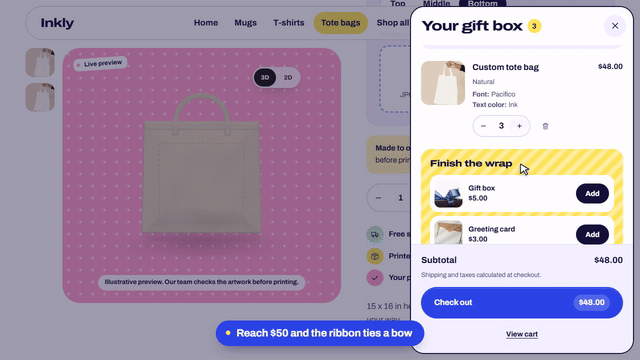

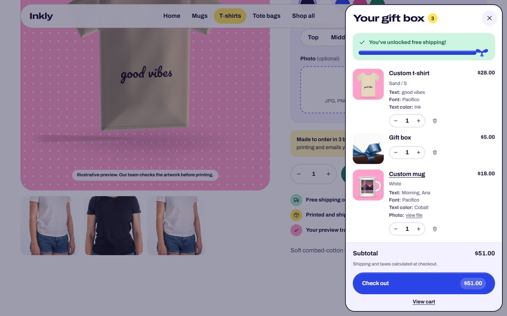

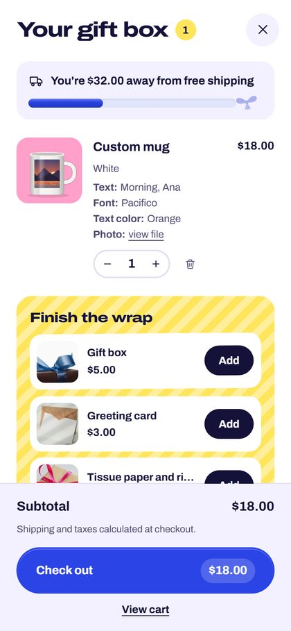

- Native `<dialog>` (focus trapped, Esc closes, focus returns where it was), refreshed with the **Section Rendering API**: adding, changing quantity and removing return the drawer HTML in the same response, with no page reload.
- **Free-shipping ribbon** driven by a theme setting and compared with the cart total after discounts; when it fills, it ties a bow.
- **Upsell** of up to three products picked in the theme editor, skipping what's already in the cart or sold out; products with options or personalization link to their page.
- **Same gift twice, one line:** adding the same personalization again raises that line's quantity. Shopify alone would add a duplicate line, because the uploaded photo and preview get a new URL on every add.
- **Checkout button with the total** in it.
- **Pix price** for Brazilian stores ("or R$ X with Pix") from a percentage setting. Display only, off by default and off in the demo store.
- **Events:** `add_to_cart`, `remove_from_cart`, `view_cart`, `view_item_list`, `upsell_added` and `free_shipping_unlocked` are published to Shopify customer events (`Shopify.analytics.publish`) and, when the setting is on, to `dataLayer` in GA4 ecommerce format.
- The `/cart` page reuses the same snippets and works without JavaScript.

Files: `sections/cart-drawer.liquid`, `snippets/cart-items.liquid`, `snippets/cart-upsell.liquid`, `snippets/free-shipping-bar.liquid`, `snippets/cart-summary.liquid`, `assets/cart-drawer.js`, `assets/cart.css`, `assets/theme.js`.

## 3. Speed, measured

The home page was first built the way many slow stores reach a freelancer, measured, and then fixed. It is not a client's store. Later the whole theme was redesigned, and the redesign had one rule: it could not be slower than the fixed version.

**What the slow version had** (commit `f901575`, tag `speed-before`):
- Google Fonts with every weight, no `preconnect` and no `font-display`, on top of the theme fonts;
- jQuery, Slick and AOS loaded synchronously in `<head>`, and the whole Font Awesome for a handful of icons;
- a 3840 px hero image as a CSS `background-image`, which the browser only discovers after the CSS, with the heading hidden by AOS until JavaScript runs;
- product grid images at 1500 px with no `srcset`, no `width`/`height` and no `loading="lazy"`;
- low-contrast gray text, an image with no `alt` and an icon link with no name.

**What the fix changed** (commit `6613c96`, tag `speed-after`):
- only Shopify-hosted fonts, with `font-display: swap` and a preload for the ones used above the fold;
- no jQuery, Slick, AOS or Font Awesome: testimonials use CSS `scroll-snap` and a few lines of deferred JavaScript, icons are inline SVG;
- a responsive hero `` with `srcset`, `sizes`, `fetchpriority="high"`, a preload and `width`/`height`;
- product grid with `srcset`, `sizes`, `loading="lazy"` and `width`/`height`;
- fixed contrast, named icon buttons and screen-reader-friendly ratings.

**What kept the redesign fast**, found by measuring each change:
- **No blurred `box-shadow`s.** Depth comes from outlines, color fields and a tilted paper sheet. Blurred shadows alone cost about 7 points on mobile.
- **A cheap first paint.** The hero's ribbon, bow, tags and polka dots are added right after `load`, and the announcement marquee starts then too; the first paint is the photo, the heading and the field. This matters more than it looks: Shopify's own `perf-kit` script draws to a small canvas and reads it back during load (a bot check). On a computer with a GPU that first read waits for the GPU to start and for the page's first paint, so an expensive first paint showed up as a longer `perf-kit` task; even on a blank page the read took 120 to 290 ms on this machine. That is also why the numbers below are measured without a GPU.
- **Patterns as tiny repeating images** instead of CSS gradients, and a plain ribbon band instead of a gradient with dashed stitching.
- **Below-the-fold CSS doesn't block rendering:** the bento, steps, reviews and footer load their stylesheets with `media="print"` swapped on load, and those sections use `content-visibility: auto`.
- **Collection and password styles live in their own files**, so the home doesn't download them; stars and separators are drawn in CSS instead of dozens of inline SVGs; the second card photo isn't loaded on touch screens.

Theme Check: 4 errors and 8 warnings in the slow version (`ParserBlockingScript`, `ImgWidthAndHeight`, `RemoteAsset`), none now.

### Measured numbers

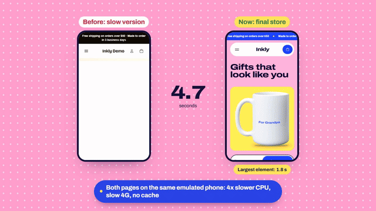

Lighthouse 13.5.0 with its default mobile emulation and its desktop preset (simulated throttling in both), 5 runs per version, the median of each metric, all on 2026-10-17 against the same store and products. **Chrome runs without a GPU (`--disable-gpu`), like the PageSpeed Insights servers:** on this machine a cold GPU makes the first canvas call in Shopify's perf-kit about 4x slower, and Lighthouse's CPU slowdown turns that into a long task no theme can avoid. PageSpeed Insights itself can't reach the store, a development store behind a password.

| Mobile, home | Slow version | After the fix | Redesign | Speed pass |
|---|---|---|---|---|
| Performance | **47** (43–48) | **76** (72–80) | **71** (71–81) | **74** (72–86) |
| LCP | **11.9 s** | **4.6 s** | **4.2 s** | **3.5 s** (2.6–3.8) |
| Total Blocking Time | 958 ms | 368 ms | 468 ms | 501 ms |
| First Contentful Paint | 2.7 s | 2.0 s | 2.1 s | 2.2 s |
| CLS | 0 | 0 | 0 | 0 |
| Accessibility | **91** | **96** | **100** | **100** |

| Mobile, personalizable product | Redesign | Speed pass |
|---|---|---|
| Performance | **69** (66–74) | **72** (67–74) |
| LCP | 3.0 s | 2.6 s |
| Total Blocking Time | 962 ms | 1,070 ms |
| Accessibility | 100 | 100 |

| Desktop | Slow version | After the fix | Redesign | Speed pass |
|---|---|---|---|---|
| Home performance | 86 (85–86) | 98 (97–98) | 98 (97–98) | 99 (97–99) |
| Home LCP | 2.4 s | 1.1 s | 1.1 s | 0.9 s |
| Product performance | | | 96 (95–98) | 93 (89–98) |

In parentheses: the lowest and highest value across the 5 runs. The spread is wide, mostly from the Shopify scripts and the home's photo race described below, so read differences of a few points as ties: the "after the fix" column is a much simpler page than the redesign. The two product columns were measured one right after the other while the machine was busier, which shows in their blocking time.

**The theme alone (a diagnostic, not a result).** With the scripts Shopify injects through `content_for_header` blocked (perf-kit, trekkie analytics, the web pixels manager, Shop Pay's shop-js, checkout prefetching and the storefront helpers), the same theme scores **96** on the home, **94** on the product page and **96** on the empty cart (mobile, Total Blocking Time 41, 98 and 101 ms; desktop 100 on all three). Every Shopify store loads those scripts; the gap between these numbers and the tables above is what they cost here.

**What the speed pass changed**, one commit each, every change measured against the step before with interleaved runs (the numbers are in the commit messages):
- The default body font, Archivo, ships with the theme as static 400 and 700 instances (16 KB each, every glyph of the library file) instead of the 45 KB variable files the Shopify font library serves. A font picked in the theme editor still comes from Shopify.
- The cart drawer's styles and script load when the browser is idle after load, when the shopper taps the cart before that, or before a product is added, instead of with every page.
- The hero and testimonials scripts and the footer styles are printed inline with `inline_asset_content`, which also minifies them, so the home makes four requests fewer before the hero photo.

**How it was measured.** Each version ran as its own theme in the demo store, served by `shopify theme dev --live-reload off` on its own local port: the `speed/before` branch at `765839e` for the slow version, tag `design-v1` at `e2299b0` for the fix before the redesign, `548113d` for the redesign as it was published in the morning, and `main` after the speed pass (with the QA and phone passes merged) for the last column. Full reports live in `lighthouse/2026-10-17/no-gpu/` (HTML to open in a browser, the JSON of the median run and `summary.json` with all 5 runs and the Chrome flags). The other folders in `lighthouse/` were measured with a GPU and aren't comparable with these numbers. To measure again: `npm run measure -- <label> <url> 5`, plus `--without-shopify-scripts` for the diagnostic.

**Why the home's LCP jumps between runs.** On the local server the CSS comes from disk in about 15 ms, while the hero photo goes through the CLI's proxy to Shopify's CDN. When the photo arrives before the first frame, LCP is the first paint (2.6 s); when it arrives a few milliseconds later, it's painted in the next frame, after perf-kit and the analytics scripts have started, and Lighthouse's model counts them in (3.4 to 3.8 s). That single race moves the home's score by about 10 points. In the interleaved runs, where each step was compared with the one before in the same minutes, the photo won the race more often after every step; in these 5 runs it won once.

**What's left isn't the theme's.** The product page's blocking time is almost all Shopify's: the web pixels manager alone accounts for about 580 ms of it, then trekkie analytics, Shop Pay's shop-js and perf-kit, while the theme's own JavaScript on that page adds about 10 ms of main-thread work. The CLI's local server also sends the HTML uncompressed over HTTP/1.1 and without a CDN, so every request costs a round trip in Lighthouse's model; on the published storefront they share one compressed HTTP/2 connection. Checkout prefetching (2 to 3 MB, loaded in some runs and not in others) is why total page weight is left out of the tables.

---

## Run it locally

You need the [Shopify CLI](https://shopify.dev/docs/api/shopify-cli) and a development store.

```bash
shopify theme dev --store your-store.myshopify.com
```

```bash
shopify theme check
```

Demo data (products, photos and menu), after authorizing the CLI on the store with `shopify store auth`:

```bash
python demo/photos.py
```

```bash
python demo/seed.py your-store.myshopify.com
```

`demo/seed.py --refresh-photos` replaces the photos of products that already exist. `demo/images.py` draws the sample customer photo used to test uploads.

Screenshots of each piece (Puppeteer with the installed Chrome, against `theme dev`):

```bash
node demo/screenshots.mjs demo/screenshots
```

## Structure

```
assets/      CSS and JavaScript for each piece, the display font, SVG icons
config/      theme settings (colors and papers, fonts, cart, Pix, tracking)
layout/      theme.liquid and password.liquid
locales/     English and Brazilian Portuguese (storefront and editor)
sections/    home, collection, product, cart (page and drawer), header, footer, password, 404
snippets/    personalizer, mockups, product card, cart items, upsell, shipping bar
templates/   JSON templates (OS 2.0), including product.personalized.json
demo/        photos, product seeding, screenshots and photo credits
lighthouse/  measuring script and reports
scripts/     Shopify CLI with a separate session (author's own setup)
```

## Third-party code

`assets/inkly-3d-scene.js` bundles [three.js](https://github.com/mrdoob/three.js) 0.186.1 (MIT, © 2010-2026 three.js authors), [delaunator](https://github.com/mapbox/delaunator) 5.1.0 (ISC, © Mapbox) and [robust-predicates](https://github.com/mourner/robust-predicates) 3.0.3 (Unlicense); its banner and three.js's `@license` comment are kept in the file. The 3D models and textures are generated in code. Photo and font credits are in `demo/CREDITS.md`.

Author: Gabriel Velozo.
