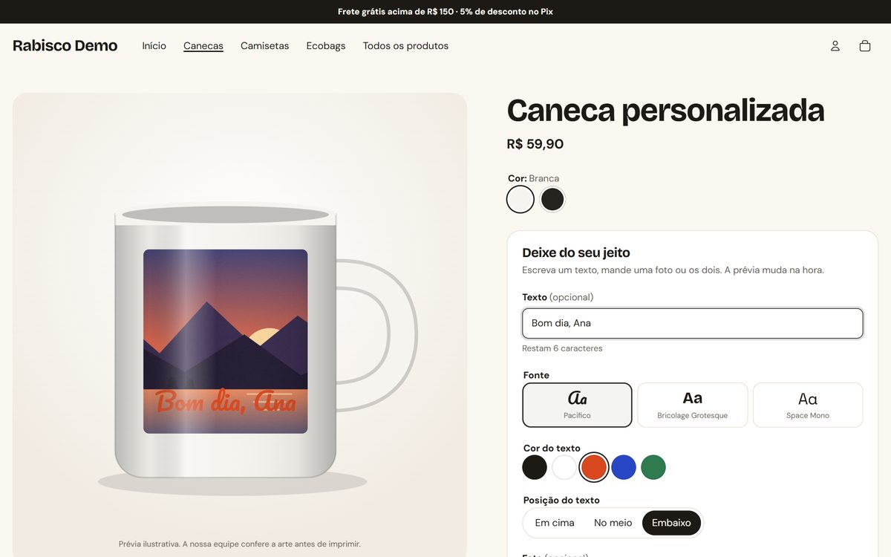
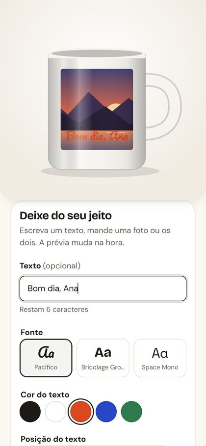
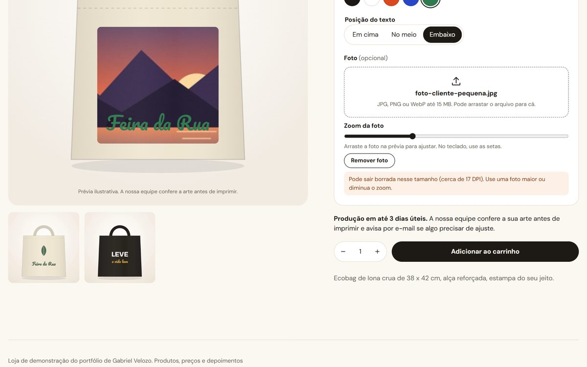
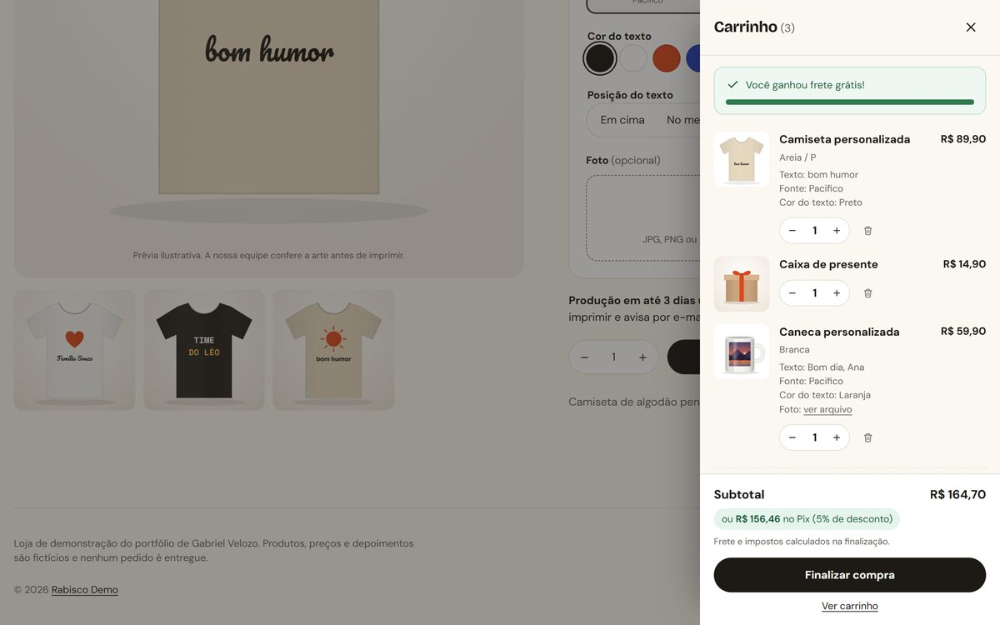
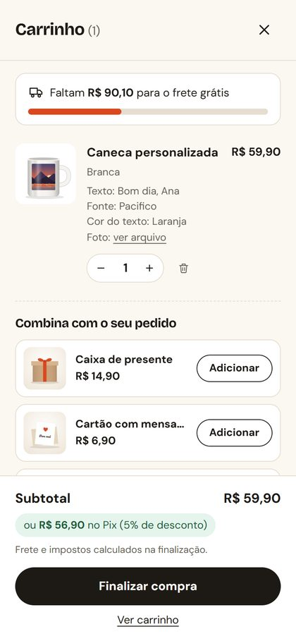

# Rabisco: tema Shopify de portfólio

Tema Shopify (Online Store 2.0) de uma loja fictícia de presentes personalizados, feito para mostrar três coisas que lojistas e agências costumam pedir: **página de produto com personalização e prévia ao vivo**, **carrinho em gaveta com upsell e frete grátis** e **ajuste de velocidade medido com Lighthouse**.

- Loja de demonstração: `rabisco-demo.myshopify.com` (loja de desenvolvimento, protegida por senha; peça a senha).
- Produtos, preços e depoimentos são fictícios. Nenhum pedido é entregue.
- Base: [Shopify Skeleton Theme](https://github.com/Shopify/skeleton-theme) v1.0.0 (commit `8b8a1f4`, licença em `LICENSE.md`). Todo o resto foi escrito do zero para este repositório.

> **In English:** a Shopify OS 2.0 theme for a fictional personalized-gifts store, built as a portfolio: a product page with live personalization preview, a cart drawer with upsell and free-shipping bar, and a speed fix measured with Lighthouse (mobile performance 42 → 63, LCP 10.8 s → 4.9 s). Details below are in Portuguese; the code and commit history tell the same story.

---

## 1. Produto personalizável com prévia ao vivo



 

O cliente escreve um texto, escolhe fonte, cor e posição, manda uma foto, arrasta e dá zoom, e vê o mockup mudar na hora. No celular a prévia fica presa no topo enquanto ele preenche.

- **Mockups em SVG** de caneca, camiseta e ecobag (`snippets/mockup.liquid`), pintados com a cor da variante escolhida. O lojista também pode usar uma imagem própria e marcar a área de impressão em porcentagem.
- **Checagem de qualidade da foto:** o tema calcula os DPI pelo tamanho real da impressão (configurável) e avisa antes da compra quando a foto vai sair borrada.
- **Aviso de contraste** quando a cor do texto quase some na cor da peça.
- **Tudo vai para o pedido** como propriedade do item: texto, fonte, cor, a foto original (upload pela Shopify) e, escondidos do cliente, a posição, o ajuste da foto e uma **imagem da prévia gerada no navegador** (canvas), que aparece no carrinho e chega para a produção.
- Teclado: a foto também se move pelas setas; os controles são `fieldset` com `legend`, e erros vão para `role="alert"`.
- Configurável no editor de tema: fontes (3 seletores da biblioteca da Shopify), cores do texto, campos obrigatórios, limite de caracteres, DPI mínimo e tamanho máximo do arquivo.

Arquivos: `sections/product.liquid`, `snippets/personalizer-controls.liquid`, `snippets/mockup.liquid`, `assets/product-personalizer.js`, `assets/product-form.js`, `assets/product.css`, `templates/product.personalizado.json`.

## 2. Carrinho em gaveta com upsell e frete grátis





- `<dialog>` nativo (foco preso, Esc fecha, foco volta para onde estava) atualizado pela **Section Rendering API**: adicionar, mudar quantidade e remover devolvem o HTML da gaveta na mesma resposta, sem recarregar a página.
- **Barra de frete grátis** com o valor das configurações do tema, comparado ao total depois dos descontos.
- **Upsell** de até 3 produtos escolhidos no editor, pulando o que já está no carrinho e o que está esgotado; produto com opções ou personalização leva para a página dele.
- **Preço no Pix** ("ou R$ X no Pix") com o percentual das configurações. É só exibição: o desconto em si vem do meio de pagamento.
- **Eventos:** `add_to_cart`, `remove_from_cart`, `view_cart`, `view_item_list`, `upsell_added` e `free_shipping_unlocked` são publicados nos eventos de cliente da Shopify (`Shopify.analytics.publish`) e, se a opção estiver ligada, no `dataLayer` no formato de e-commerce do GA4.
- A página `/cart` usa os mesmos snippets e funciona sem JavaScript.

Arquivos: `sections/cart-drawer.liquid`, `snippets/cart-items.liquid`, `snippets/cart-upsell.liquid`, `snippets/free-shipping-bar.liquid`, `snippets/cart-summary.liquid`, `assets/cart-drawer.js`, `assets/cart.css`, `assets/theme.js`.

## 3. Velocidade: a mesma home, antes e depois


A home foi montada primeiro do jeito que muita loja lenta chega para um freelancer, medida, e depois ajustada. Não é a loja de um cliente.

**O que a versão "antes" tinha** (commit `f901575`, tag `velocidade-antes`):
- Google Fonts com todas as variações, sem `preconnect` e sem `font-display`, por cima das fontes do tema;
- jQuery, Slick e AOS síncronos no `<head>`, e o Font Awesome inteiro só para alguns ícones;
- banner com a imagem de 3840 px em `background-image`, que o navegador só descobre depois do CSS, e o título escondido pelo AOS até o JavaScript rodar;
- vitrine com imagens de 1500 px sem `srcset`, sem `width`/`height` e sem `loading="lazy"`;
- texto cinza claro sem contraste, imagem sem `alt` e ícone sem nome.

**O que mudou** (commit `6613c96`, tag `velocidade-depois`, mais o ajuste do banner no celular em `dac6ad1`):
- só as fontes da biblioteca da Shopify, com `font-display: swap` e preload das duas usadas acima da dobra;
- sem jQuery, Slick, AOS e Font Awesome: depoimentos em `scroll-snap` com 30 linhas de JavaScript com `defer`, ícones em SVG inline;
- banner com `` responsiva (`srcset` de 600 a 2400 px, `sizes="100vw"`), `fetchpriority="high"`, preload e `width`/`height`; no celular o texto vem antes da imagem e aparece sem depender de JavaScript;
- vitrine com `srcset`, `sizes`, `loading="lazy"` e `width`/`height`;
- contraste corrigido, nome nos botões de ícone e nota dos depoimentos legível por leitor de tela.

Theme Check: 4 erros e 8 avisos antes (`ParserBlockingScript`, `ImgWidthAndHeight`, `RemoteAsset`), nenhum depois.

### Números medidos

Lighthouse 13.5.0, 5 rodadas de cada lado, **mediana** (rodada escolhida por `computeMedianRun`), em 15/10/2026.

| Celular | Antes | Depois |
|---|---|---|
| Performance | **42** (39–44) | **63** (54–64) |
| LCP | **10,8 s** (10,8–11,9) | **4,9 s** (4,4–5,7) |
| Total Blocking Time | **1.776 ms** (1.311–2.019) | **784 ms** (489–1.562) |
| First Contentful Paint | 2,8 s | 2,2 s |
| CLS | 0 | 0 |
| Acessibilidade | **91** | **96** |
| Peso da página | 4.194 KB | 3.172 KB |

| Desktop | Antes | Depois |
|---|---|---|
| Performance | 78 (76–79) | 77 (75–90) |
| LCP | 2,2 s | 1,3 s |
| Total Blocking Time | 233 ms (225–280) | 418 ms (181–516) |
| Acessibilidade | 91 | 96 |

Entre parênteses, o menor e o maior valor das 5 rodadas. No desktop a nota de performance ficou igual e o TBT variou muito entre rodadas dos dois lados, então não dá para dizer que melhorou ou piorou ali; o ganho claro é no celular e no LCP.

**Como foi medido.** As duas versões rodaram no mesmo tema de desenvolvimento, servido por `shopify theme dev --live-reload off` em `http://127.0.0.1:9292/`, com o Lighthouse simulando um celular (throttling simulado, padrão do Lighthouse). O "antes" medido é o branch `velocidade/antes` (commit `fd84bee`: o tema atual com o `theme.liquid` e as quatro seções da home de `velocidade-antes`); o "depois" é o `main` no commit `dac6ad1`. Os relatórios completos estão em `lighthouse/antes/` e `lighthouse/depois/` (HTML para abrir no navegador e JSON da rodada mediana, mais `resumo.json` com as 5 rodadas). Para medir de novo: `npm run medir -- <rótulo> <url> 5`.

**O que sobra e não é do tema.** O servidor local do CLI entrega o HTML sem compressão e sem CDN, nas duas medições; na loja publicada os números absolutos tendem a ser melhores, mas não medi isso. E a maior parte do peso e do bloqueio que restou vem dos scripts que a própria Shopify injeta pelo `content_for_header`: o pré-carregamento do checkout (cerca de 2,3 MB), o perf-kit, o gerenciador de pixels e o analytics. Nenhum tema remove isso. No que o tema controla, o relatório de depois não aponta imagem grande, fonte bloqueando nem script de terceiros.

---

## Rodar localmente

Precisa do [Shopify CLI](https://shopify.dev/docs/api/shopify-cli) e de uma loja de desenvolvimento.

```bash
shopify theme dev --store sua-loja.myshopify.com
```

```bash
shopify theme check
```

Dados da loja de demonstração (produtos, fotos, banner e menu), depois de autorizar o CLI na loja com `shopify store auth`:

```bash
python demo/imagens.py
```

```bash
python demo/semear.py sua-loja.myshopify.com
```

Prints das peças (Puppeteer com o Chrome instalado, contra o `theme dev`):

```bash
node demo/prints.mjs demo/prints
```

## Estrutura

```
assets/      CSS e JavaScript de cada peça, ícones SVG
config/      configurações do tema (cores, fontes, carrinho, Pix, rastreamento)
layout/      theme.liquid
locales/     pt-BR e inglês (textos da loja e do editor)
sections/    produto, carrinho (página e gaveta), home, cabeçalho, rodapé
snippets/    personalizador, mockups, itens do carrinho, upsell, barra de frete
templates/   JSON (OS 2.0), incluindo product.personalizado.json
demo/        imagens fictícias, criação dos produtos e prints
lighthouse/  script de medição e relatórios de antes e depois
scripts/     Shopify CLI com sessão separada (uso pessoal do autor)
```

Autor: Gabriel Velozo.
