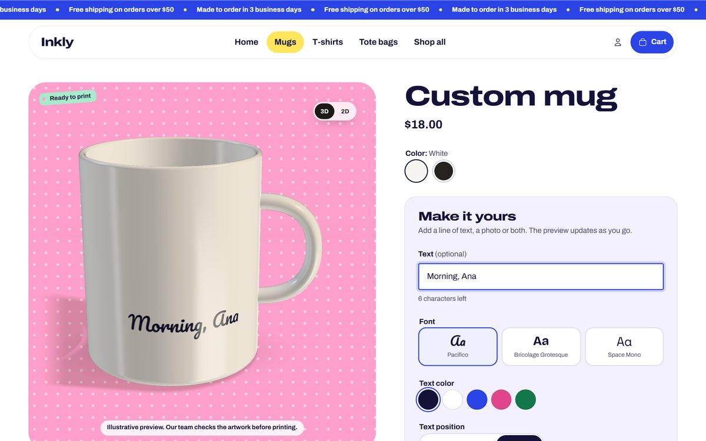

# Inkly: a Shopify portfolio theme

A Shopify Online Store 2.0 theme for a fictional personalized-gifts store, built to show three things merchants and agencies keep asking for: **a product page with live personalization preview**, **a cart drawer with upsell and a free-shipping bar**, and **speed measured with Lighthouse**.


- Demo store: `inkly-demo.myshopify.com` (a development store, so it's password protected; ask for the password).
- Products, prices and reviews are fictional. No orders are fulfilled.
- Base: [Shopify Skeleton Theme](https://github.com/Shopify/skeleton-theme) v1.0.0 (commit `8b8a1f4`, license in `LICENSE.md`). Everything else was written from scratch for this repository.
- Storefront strings ship in English (default) and Brazilian Portuguese.

## The look: a gift-wrap counter

The whole store is wrapping paper. Each part of the home owns one paper (pink polka dots, lemon stripes, mint gingham, cobalt), a cobalt ribbon carries the live state (the announcement, the free-shipping progress in the cart, the steps rail on the home) and gift tags label what matters.

 

- **Type a name, see it on the mug.** The hero has a field that prints what the visitor types onto a real mug photo, live. "Make yours" opens the mug with that text already filled in the personalizer.
- **Type:** Archivo Expanded ExtraBold for headings, shipped with the theme (14 KB, SIL Open Font License); Archivo for body text, picked from the Shopify font library and changeable in the theme editor.
- **Papers are CSS:** the patterns are tiny repeating images defined once in `assets/critical.css`, and their colors are theme settings.
- **Motion:** the steps ribbon draws itself as you scroll, the hero gets dressed (ribbon, bow, tags) right after load, tags swing on hover, "Add to cart" pops into "Added!", the cart badge bumps, and the free-shipping ribbon ties a bow with a burst of confetti. All of it is off under `prefers-reduced-motion`.
- **State shows on the paper:** on the product page the stage tag turns into a mint "Ready to print" once there is text or a sharp photo, and the stage paper turns lemon for dark products.
- **Pages:** home (hero, bestsellers, gift bento, how it works, reviews), collection, product, cart drawer and cart page, password page and a 404 shaped like "4[mug]4".
- **Photos** are free stock photos (Burst, Unsplash, Pexels), cropped by `demo/photos.py`; sources and licenses are in `demo/CREDITS.md` and in each file's metadata. The hero mug is cut out of its studio backdrop by `demo/cutout.py` and laid on a lemon card, so it ships as a 13 KB image instead of a heavy transparent one.

---

## 1. Product personalizer with live preview


 

 

The customer types a line of text, picks a font, a color and a position, uploads a photo, drags and zooms it, and watches the mockup update as they go. On mobile the preview stays pinned to the top while they fill in the form.

- **SVG mockups** of a mug, a tee and a tote bag (`snippets/mockup.liquid`), tinted with the selected variant color. A merchant can also use their own mockup image and mark the print area in percentages.
- **Print quality check:** the theme computes DPI from the real print width (a setting) and warns before checkout when the photo will print blurry.
- **Contrast warning** when the text color nearly disappears on the product color.
- **Everything goes into the order** as line item properties: text, font, color, the original photo (uploaded through Shopify) and, hidden from the customer, the text position, the photo adjustment and a **preview image rendered in the browser** (canvas), which shows up in the cart and reaches production.
- **Live 3D preview** on top of the 2D mockup: a procedural three.js mug, tee and tote that print the customer's text and photo by mirroring the mockup `<svg>`, with light and reflections that follow the pointer and drag (or swipe) to turn the product. A 3D/2D switch sits on the stage; photo dragging stays in 2D. The page loads a 3 KB loader (`assets/inkly-3d.js`); three.js and the models (`assets/inkly-3d-scene.js`, 155 KB gzip) are only requested after the shopper first interacts with the page. Without WebGL2 the 2D preview simply stays. Measured on the product page (5 runs each, mobile / desktop): 54 / 73 before adding it and 52 / 75 after (`lighthouse/2026-10-17/product-2d` and `product-3d`); the spread between runs is larger than that difference. The font samples in the personalizer switch to their own fonts right after load, which keeps about 150 KB of fonts off the first paint.
- **Prefill from a link:** `?text=` on the product URL fills the text field (used by the home hero).
- Keyboard support: the photo also moves with the arrow keys; controls are `fieldset`s with `legend`s and errors go to `role="alert"`.
- Configurable in the theme editor: fonts (three pickers from the Shopify font library), text colors, required fields, character limit, minimum DPI and maximum file size.

Files: `sections/product.liquid`, `snippets/personalizer-controls.liquid`, `snippets/mockup.liquid`, `snippets/inkly-3d.liquid`, `assets/product-personalizer.js`, `assets/product-form.js`, `assets/inkly-3d.js`, `assets/inkly-3d-scene.js`, `assets/product.css`, `templates/product.personalized.json`.

## 2. Cart drawer with upsell and free-shipping bar


- Native `<dialog>` (focus trapped, Esc closes, focus returns where it was), refreshed with the **Section Rendering API**: adding, changing quantity and removing return the drawer HTML in the same response, with no page reload.
- **Free-shipping ribbon** driven by a theme setting and compared with the cart total after discounts; when it fills, it ties a bow.
- **Upsell** of up to three products picked in the theme editor, skipping what's already in the cart or sold out; products with options or personalization link to their page.
- **Checkout button with the total** in it.
- **Pix price** for Brazilian stores ("or R$ X with Pix") from a percentage setting. Display only, off by default and off in the demo store.
- **Events:** `add_to_cart`, `remove_from_cart`, `view_cart`, `view_item_list`, `upsell_added` and `free_shipping_unlocked` are published to Shopify customer events (`Shopify.analytics.publish`) and, when the setting is on, to `dataLayer` in GA4 ecommerce format.
- The `/cart` page reuses the same snippets and works without JavaScript.

Files: `sections/cart-drawer.liquid`, `snippets/cart-items.liquid`, `snippets/cart-upsell.liquid`, `snippets/free-shipping-bar.liquid`, `snippets/cart-summary.liquid`, `assets/cart-drawer.js`, `assets/cart.css`, `assets/theme.js`.

## 3. Speed, measured

The home page was first built the way many slow stores reach a freelancer, measured, and then fixed. It is not a client's store. Later the whole theme was redesigned, and the redesign had one rule: it could not be slower than the fixed version.

**What the slow version had** (commit `f901575`, tag `speed-before`):
- Google Fonts with every weight, no `preconnect` and no `font-display`, on top of the theme fonts;
- jQuery, Slick and AOS loaded synchronously in `<head>`, and the whole Font Awesome for a handful of icons;
- a 3840 px hero image as a CSS `background-image`, which the browser only discovers after the CSS, with the heading hidden by AOS until JavaScript runs;
- product grid images at 1500 px with no `srcset`, no `width`/`height` and no `loading="lazy"`;
- low-contrast gray text, an image with no `alt` and an icon link with no name.

**What the fix changed** (commit `6613c96`, tag `speed-after`):
- only Shopify-hosted fonts, with `font-display: swap` and a preload for the ones used above the fold;
- no jQuery, Slick, AOS or Font Awesome: testimonials use CSS `scroll-snap` and a few lines of deferred JavaScript, icons are inline SVG;
- a responsive hero `` with `srcset`, `sizes`, `fetchpriority="high"`, a preload and `width`/`height`;
- product grid with `srcset`, `sizes`, `loading="lazy"` and `width`/`height`;
- fixed contrast, named icon buttons and screen-reader-friendly ratings.

**What kept the redesign fast**, found by measuring each change:
- **No blurred `box-shadow`s.** Depth comes from outlines, color fields and a tilted paper sheet. Blurred shadows alone cost about 7 points on mobile.
- **A cheap first paint.** The hero's ribbon, bow, tags and polka dots are added right after `load`, and the announcement marquee starts then too; the first paint is the photo, the heading and the field. This matters more than it looks: Shopify's own `perf-kit` script draws to a canvas and reads it back during load, and that read waits for the page to finish painting, so an expensive first paint shows up as a long `perf-kit` task (about 180 ms with this approach, about 350 ms without it, before CPU throttling).
- **Patterns as tiny repeating images** instead of CSS gradients, and a plain ribbon band instead of a gradient with dashed stitching.
- **Below-the-fold CSS doesn't block rendering:** the bento, steps, reviews and footer load their stylesheets with `media="print"` swapped on load, and those sections use `content-visibility: auto`.
- **Collection and password styles live in their own files**, so the home doesn't download them; stars and separators are drawn in CSS instead of dozens of inline SVGs; the second card photo isn't loaded on touch screens.

Theme Check: 4 errors and 8 warnings in the slow version (`ParserBlockingScript`, `ImgWidthAndHeight`, `RemoteAsset`), none now.

### Measured numbers

Lighthouse 13.5.0, 5 runs per version, **median** (the run chosen by `computeMedianRun`), all three on 2026-10-17, against the same store and products.

| Mobile | Slow version | After the fix | Redesign (now) |
|---|---|---|---|
| Performance | **44** (42–48) | **67** (62–69) | **66** (64–68) |
| LCP | **12.7 s** (11.8–13.4) | **4.8 s** (4.5–6.0) | **4.5 s** (4.4–5.1) |
| Total Blocking Time | **1,328 ms** (899–1,468) | **559 ms** (340–627) | **584 ms** (542–680) |
| First Contentful Paint | 2.7 s | 2.0 s | 2.1 s |
| CLS | 0 | 0 | 0 |
| Accessibility | **91** | **96** | **100** |

| Desktop | Slow version | After the fix | Redesign (now) |
|---|---|---|---|
| Performance | 82 (82–83) | 93 (86–96) | 95 (93–97) |
| LCP | 2.4 s | 1.3 s | 1.2 s |
| Total Blocking Time | 163 ms | 141 ms (79–277) | 130 ms (82–157) |
| Accessibility | 91 | 96 | 100 |

In parentheses: the lowest and highest value across the 5 runs. The run-to-run spread is wide, mostly from the Shopify scripts described below, so read the mobile scores of the last two columns as a tie: the redesign is a much richer page and kept the fixed version's speed, with a faster LCP, full accessibility marks and a better desktop score.

**How it was measured.** Each version ran as its own theme in the demo store, served by `shopify theme dev --live-reload off` on its own local port (`speed/before` branch at `765839e` for the slow version, tag `design-v1` at `e2299b0` for the fixed version before the redesign, `main` for the redesign), with Lighthouse's default mobile emulation and its desktop preset (simulated throttling in both). Full reports live in `lighthouse/2026-10-17/` (HTML to open in a browser, the JSON of the median run and `summary.json` with all 5 runs). The first measurement, on 2026-10-16 (mobile 37 → 65), is kept in `lighthouse/before/` and `lighthouse/after/`. To measure again: `npm run measure -- <label> <url> 5`.

**What's left isn't the theme's.** The CLI's local server sends the HTML without compression and without a CDN; numbers on the published storefront should be better in absolute terms, but I didn't measure that. Most of the remaining weight and blocking time comes from the scripts Shopify injects through `content_for_header`: checkout prefetching (2 to 3 MB, loaded in some runs and not in others), perf-kit, the web pixels manager and analytics. No theme can remove those, which is why total page weight is left out of the tables.

---

## Run it locally

You need the [Shopify CLI](https://shopify.dev/docs/api/shopify-cli) and a development store.

```bash
shopify theme dev --store your-store.myshopify.com
```

```bash
shopify theme check
```

Demo data (products, photos and menu), after authorizing the CLI on the store with `shopify store auth`:

```bash
python demo/photos.py
```

```bash
python demo/seed.py your-store.myshopify.com
```

`demo/seed.py --refresh-photos` replaces the photos of products that already exist. `demo/images.py` draws the sample customer photo used to test uploads.

Screenshots of each piece (Puppeteer with the installed Chrome, against `theme dev`):

```bash
node demo/screenshots.mjs demo/screenshots
```

## Structure

```
assets/      CSS and JavaScript for each piece, the display font, SVG icons
config/      theme settings (colors and papers, fonts, cart, Pix, tracking)
layout/      theme.liquid and password.liquid
locales/     English and Brazilian Portuguese (storefront and editor)
sections/    home, collection, product, cart (page and drawer), header, footer, password, 404
snippets/    personalizer, mockups, product card, cart items, upsell, shipping bar
templates/   JSON templates (OS 2.0), including product.personalized.json
demo/        photos, product seeding, screenshots and photo credits
lighthouse/  measuring script and reports
scripts/     Shopify CLI with a separate session (author's own setup)
```

## Third-party code

`assets/inkly-3d-scene.js` bundles [three.js](https://github.com/mrdoob/three.js) 0.186.1 (MIT, © 2010-2026 three.js authors), [delaunator](https://github.com/mapbox/delaunator) 5.1.0 (ISC, © Mapbox) and [robust-predicates](https://github.com/mourner/robust-predicates) 3.0.3 (Unlicense); its banner and three.js's `@license` comment are kept in the file. The 3D models and textures are generated in code. Photo and font credits are in `demo/CREDITS.md`.

Author: Gabriel Velozo.
